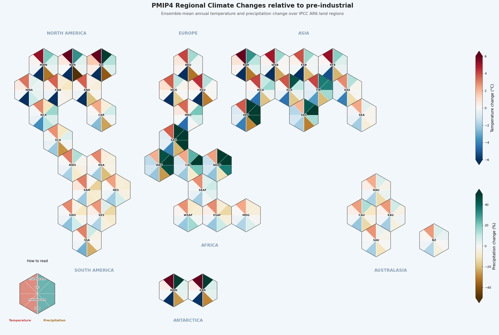
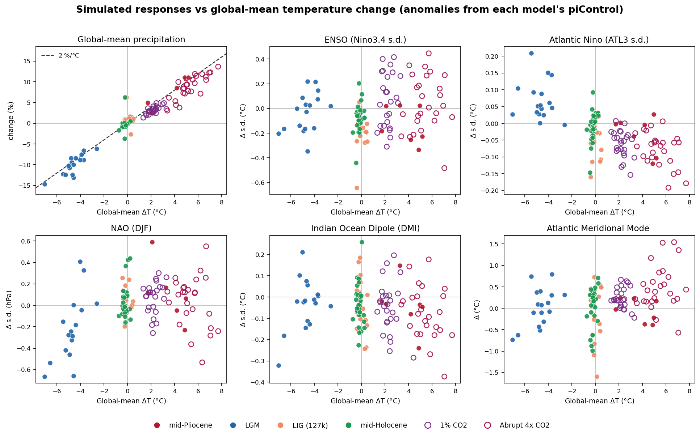
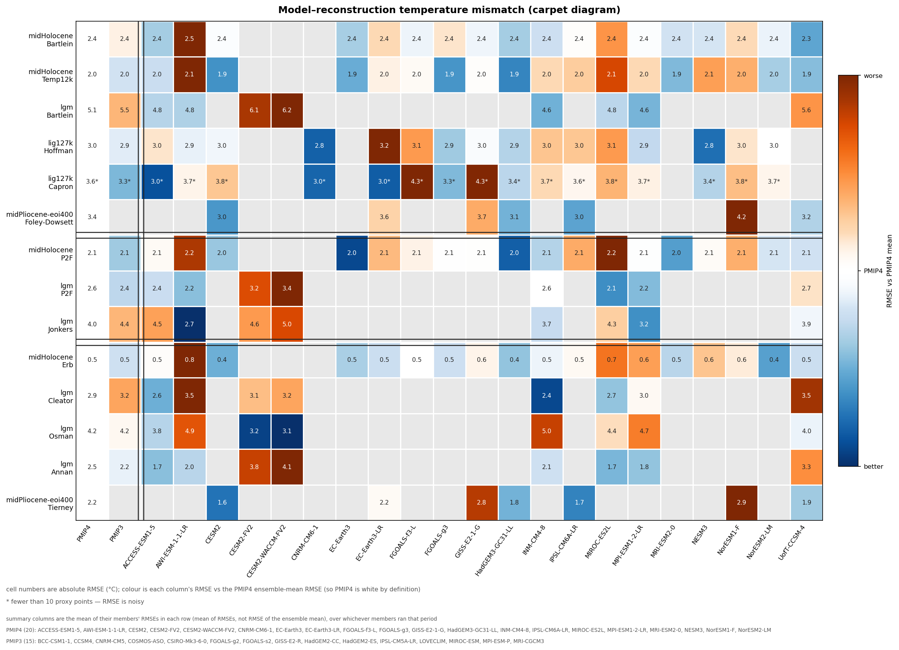
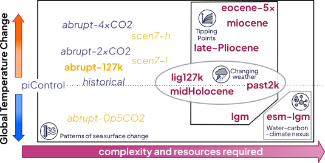

# Outline and code to create a paper summarising PMIP4+ and PMIP7 paper

**This effort is led by Chris Brierley (c.brierley@ucl.ac.uk). The most recent posted draft is from [17th Nov 2026](PMIP_vision_draft_17nov26.pdf)**

_Rationale:_ This manuscript is intended as a position piece to motivate PMIP7. It will also attempt to summarise the results arising from PMIP4, and categorise which bits of that science happened after AR6.

### Introduction
* Talk about past climate changes as an independent test of model
* Historical background on PMIP
* Explain set-up of PMIP4 and some facts about its inclusion in AR6

### Past climates
* Explain the spread of periods (intro paragraph setting up WGs; then short paragraph on each)
  * mid-Holocene
  * last glacial maximum
  * Last interglacial
  * Pliocene
  * early Eocene
  * past2k

* Include table providing a summary. Base on IPCC AR6 TS table, with # models in each (Chris)

### Insights into past climates
* lig127k was new inclusion in CMIP6. Lots of focus on Arctic - learnt that it was seasonally ice-free(?) and only few models can capture this
* Some examples on the regional level?
* Maybe discuss how the model simulations can support insights being drawn from data: [Wharton et al](https://www.nature.com/articles/s41586-024-07655-y) and [Gray et al](https://agupubs.onlinelibrary.wiley.com/doi/full/10.1029/2023PA004666) as examples?

[Figure 1: Comparing regional climate change sginals across experiments, created using the synthesis code.](synthesis_figure/output/synthesis_hexfig.png)

[Figure 2: Scatterplots relating climate indices and modes to global mean temperature change across time periods: after Rehfeld et al 2020](scatterplots/output/scatter_vs_gmt.png)

### Benchmarking

* Provide a (brief) literature review of the benchmarking performed before: separate papers for periods; attempt to combine in IPCC carpet diagram.

* I'm focussing just on surface temperature here (and assuming that SST and SAT anomalies are the same). Each row is a different proxy compilation. Each column is a different model, although the ensmeble mean of PMIP4 and PMIP3 are the first two. 

*First, I've pulled together the existing results from the various single-period papers into a single carpet diagram (top 6 rows). Then I've included some new proxy compilations (middle 3 rows), and finally there are some data assimmilation products. 

[Figure 3: Benchmarking models' surface air temperature across multi-periods, created using the carpet_diagram code.](carpet_diagram/output/carpet_diagram.png)

_It could be that the lack of any main messages arises from the global averaging approach, missing important regional patterns (esp for midHolocene and lig127k). The same benchmarking can be cut to a smaller region. We've tried looking at IPCC regions that include a bit of ocean and land. Neither of them really improve the story however. For example, see a [Euro-Atlantic version (45–66.33°N, 30°W–15°E)](carpet_diagram/output/carpet_diagram_euroatlantic.png) and a [Mediterranean one](carpet_diagram/output/carpet_diagram_med.png)._

### Paleodata Assimilation
* There has been several advances in the topic since PMIP4 was released, and many of them use PMIP4 data to help establish their priors.
* Push into benchmarking against these DA datasets (although noting the circularity).

## Discussion
### Insights for future climate 
* A brief paragraph talking about the benefit of past for future insights.
* Paragraph summarising multi-model studies that include the future: drawing connections within model world
* Paragraph looking at paleo-constraints. Discuss Lunt et al (2024) constraining ECS directly using PMIP outputs. Jiang Zhu's palaeo-calibrated CESM2 and Peter Hopcroft's work
* Paragraph pushing into work explaining the physical mechanisms: e.g. Yoshimori et al; He at al
* Any quantitative examples (maybe Osman et al 2026) 

[Figure 4: Schematic showing examples of how to leverage insight from paleoclimate models into future projections](future_methodology\PMIP_future_constraint.png)

### Outlook for PMIP7

[Figure 5: The PMIP7 experiments and their relationship to CMIP7.](expts-plan/expts-plan.temp-vs-resources.png)

* Brief description of CMIP7, and slightly shifted nature of PMIP within it
* Describe abrupt127k experiment and focus on Arctic
* Explain expansion into Miocene
* Data assimilation and shift in focus of past2k simulation
* Proxy modelling as a benchmarking approach (with mid-Holocene)?
* Suggest something about near-term timings
* Wider vision and summary
